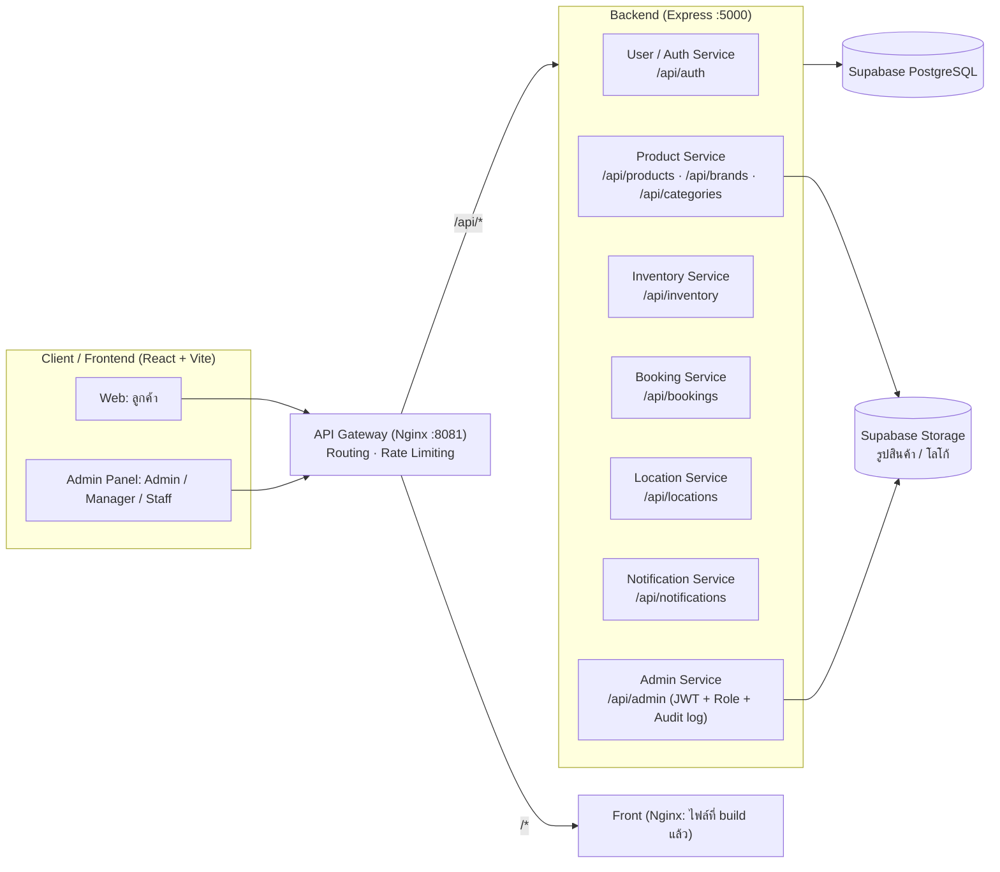
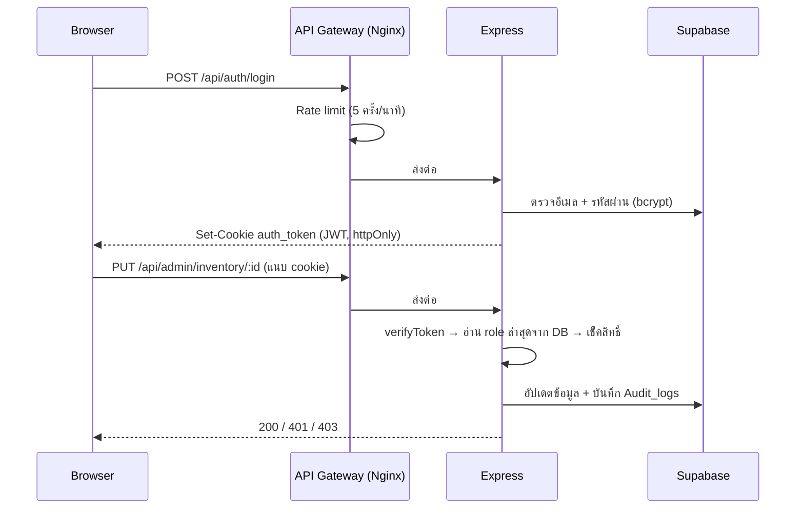

# Grand Service: Architecture

ระบบร้านนาฬิกา: ลูกค้าดูสินค้าและจองนัดดูนาฬิกาที่สาขา ส่วนพนักงานจัดการสินค้า สต็อก การจอง และสาขาผ่าน Admin Panel

## ภาพรวม



## เส้นทางข้อมูล (Data Flow)



## หน้าที่ของแต่ละ Service

| Service | Path | หน้าที่ | ตารางที่ใช้ |
|---|---|---|---|
| User / Auth | `/api/auth` | สมัคร (OTP), login, logout, ลืมรหัส, โปรไฟล์ | `Profiles` |
| Product | `/api/products`, `/api/brands`, `/api/categories` | ข้อมูลรุ่นนาฬิกา แบรนด์ หมวดหมู่ รูปภาพ | `Products`, `Product_Images`, `brands`, `Categories` |
| Inventory | `/api/inventory` | นาฬิกาทีละเรือน (Serial, สถานะ, ที่เก็บ) | `Inventory` |
| Booking | `/api/bookings` | จองนัดดูนาฬิกา, ช่วงเวลาที่ถูกจอง, การจองของลูกค้า | `bookings` |
| Location | `/api/locations` | สาขาที่เปิดให้จอง | `locations` |
| Notification | `/api/notifications` | แจ้งเตือนของลูกค้า | `notifications` |
| Admin | `/api/admin` | จัดการทุกอย่างหลังร้าน + สิทธิ์ตาม role + บันทึกประวัติ | ทุกตาราง + `Audit_logs` |

## API Gateway (Nginx)

ไฟล์: [`gateway/nginx.conf`](../gateway/nginx.conf)

| เส้นทาง | ส่งไปที่ | Rate limit ต่อ IP |
|---|---|---|
| `/api/auth/login`, `register`, `forgot-password`, `reset-password` | back:5000 | 5 ครั้ง/นาที (เกินได้ 429) |
| `/api/*` | back:5000 | 20 ครั้ง/วินาที |
| `/*` | front:80 | - |

ทุก request ต้องผ่าน Gateway มีแค่ Gateway ที่เปิดพอร์ต (8081) ออกนอก Docker ส่วน back กับ front เข้าได้จากในเครือข่าย Docker เท่านั้น

## Security

- **JWT:** login แล้วได้ `auth_token` ใน cookie แบบ `httpOnly` + `sameSite=strict` อายุ 1 วัน ส่วน `verifyToken` ตรวจ token ทุก request ที่ต้อง login
- **Role ล่าสุด:** อ่าน role จากฐานข้อมูลทุกครั้ง (ไม่เชื่อค่าใน token) ถ้าลดสิทธิ์ใครจะมีผลทันที
- **Service role key:** ใช้เฉพาะฝั่ง server (`Back/Config/adminSupabase.js`) ไม่เคยส่งไปหน้าเว็บ
- **Audit log:** ทุกการเพิ่ม แก้ ลบ ในแอดมินบันทึกลง `Audit_logs` (ใคร ทำอะไร ค่าเดิม → ค่าใหม่)

### สิทธิ์ของแต่ละ role

| | ไม่ login | Customer | Staff | Manager | Admin |
|---|:-:|:-:|:-:|:-:|:-:|
| ดูสินค้า / แบรนด์ / หมวดหมู่ / สาขา / สต็อก | ✓ | ✓ | ✓ | ✓ | ✓ |
| ดูช่วงเวลาที่ถูกจอง, สร้างการจอง | ✓ | ✓ | ✓ | ✓ | ✓ |
| ดูการจอง / แจ้งเตือนของตัวเอง | - | ✓ | ✓ | ✓ | ✓ |
| ดูการจองทั้งหมด | - | - | ✓ | ✓ | ✓ |
| เพิ่ม / แก้สต็อก, เปลี่ยนสถานะการจอง | - | - | ✓ | ✓ | ✓ |
| เพิ่ม / แก้ / ลบ สินค้า แบรนด์ หมวดหมู่ สาขา | - | - | - | ✓ | ✓ |
| ลบสต็อก / ลบการจอง, ดูประวัติการแก้ไข | - | - | - | ✓ | ✓ |
| จัดการผู้ใช้และ role | - | - | - | - | ✓ |

ไม่ได้ login ได้ `401` ส่วน login แล้วแต่ไม่มีสิทธิ์ได้ `403`

## Endpoints

| Method | Path | สิทธิ์ |
|---|---|---|
| POST | `/api/auth/register/request-otp`, `/register/verify-otp`, `/login`, `/logout`, `/forgot-password`, `/reset-password` | ทุกคน |
| GET / PUT | `/api/auth/me`, `/api/auth/profile` | login |
| GET | `/api/products`, `/api/products/:id`, `/api/brands`, `/api/categories`, `/api/categories/:id`, `/api/inventory`, `/api/inventory/product/:productId`, `/api/locations` | ทุกคน |
| POST / PUT / DELETE | `/api/products`, `/api/brands`, `/api/categories` (`/:id`) | Manager+ |
| POST | `/api/inventory` | Staff+ |
| GET | `/api/bookings/booked-slots` | ทุกคน |
| POST | `/api/bookings` | ทุกคน |
| GET | `/api/bookings/user/:customerId` | เจ้าของ หรือ Staff+ |
| GET | `/api/bookings`, `/api/bookings/:id` | Staff+ |
| DELETE | `/api/bookings/:id` | Manager+ |
| GET | `/api/notifications/:customerId` | เจ้าของ หรือ Staff+ |
| PATCH | `/api/notifications/:id/read` | เจ้าของ หรือ Staff+ |
| GET | `/api/admin/stats`, `/bookings`, `/locations` | Staff+ |
| POST / PUT | `/api/admin/inventory`, `/bookings`, `/bookings/:id/status` | Staff+ |
| POST / PUT / DELETE | `/api/admin/products`, `/brands`, `/categories`, `/locations`, `/inventory/:id` (ลบ), `/bookings/:id` (ลบ) | Manager+ |
| GET | `/api/admin/audit-logs` | Manager+ |
| GET / PUT / DELETE | `/api/admin/users` (`/:id`, `/:id/role`) | Admin |

## รันผ่าน Docker

```bash
docker compose up --build
```

เปิด `http://localhost:8081` ส่วน `Back/.env` ถูกอ่านตอนรัน ไม่ได้ใส่ลงใน image

```bash
docker compose down
```
