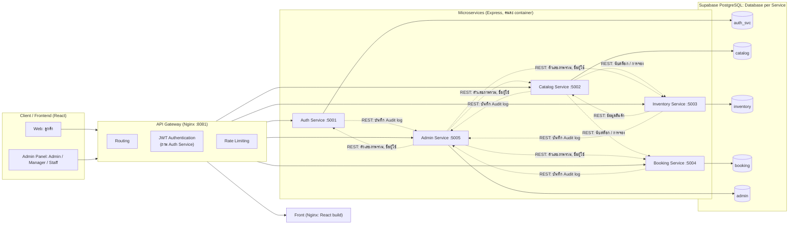
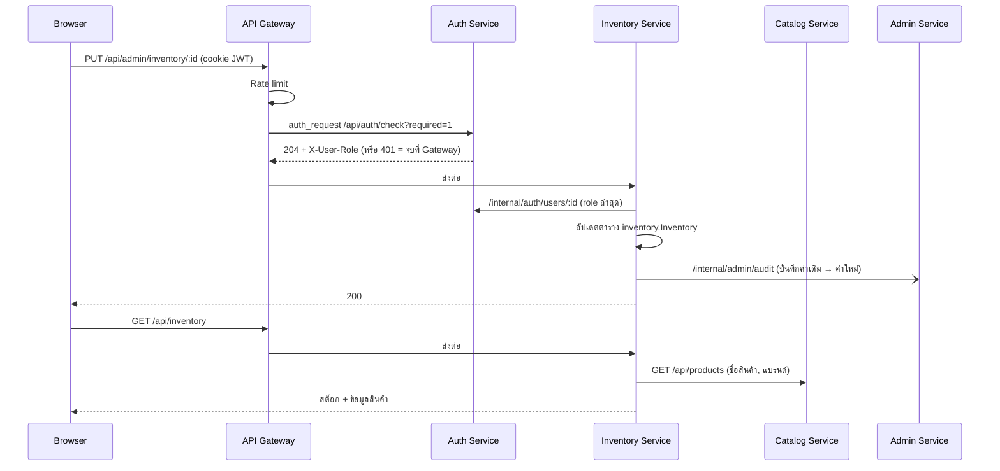

# Grand Service: Microservices Architecture

ระบบร้านนาฬิกา: ลูกค้าดูสินค้าและจองนัดดูนาฬิกาที่สาขา ส่วนพนักงานจัดการสินค้า สต็อก การจอง และสาขาผ่าน Admin Panel

## ภาพรวม



- เส้นทึบ = request จากหน้าเว็บ
- เส้นประ = service คุยกันเองผ่าน REST (`/internal/*`)

## Microservices

| Service | Container : Port | Path ที่รับผิดชอบ | Database (schema) | ตาราง |
|---|---|---|---|---|
| **Auth** | `auth:5001` | `/api/auth/*`, `/api/admin/users*` | `auth_svc` | `Profiles` |
| **Catalog** | `catalog:5002` | `/api/products`, `/api/brands`, `/api/categories`, `/api/admin/{products,brands,categories}*` | `catalog` | `Products`, `Product_Images`, `brands`, `Categories` |
| **Inventory** | `inventory:5003` | `/api/inventory`, `/api/admin/inventory*` | `inventory` | `Inventory` |
| **Booking** | `booking:5004` | `/api/bookings`, `/api/locations`, `/api/notifications`, `/api/admin/{bookings,locations}*` | `booking` | `bookings`, `locations`, `Notifications` |
| **Admin** | `admin:5005` | `/api/admin/stats`, `/api/admin/audit-logs` | `admin` | `Audit_logs` |

- **โค้ดชุดเดียวกัน แยกกันรัน:** ทุก service ใช้ image เดียวกัน (`Back/`) แต่รันคนละ entry ผ่าน `node apps/start.js <service>`
- **ตารางว่า service ไหนเปิด route อะไร:** อยู่ที่ [`Back/apps/registry.js`](../Back/apps/registry.js)

## Database per Service

- **แยก schema:** แต่ละ service มี schema ของตัวเองใน Supabase PostgreSQL (สร้างด้วย [`docs/sql/01_service_schemas.sql`](sql/01_service_schemas.sql))
- **ต่อเฉพาะ schema ของตัวเอง:** ทุก service เชื่อมต่อผ่าน [`Back/Config/db.js`](../Back/Config/db.js) เช่น Catalog ใช้ `catalogDb` ซึ่งเห็นแค่ schema `catalog`
- **ไม่ผูก foreign key ข้าม service:** ข้อมูลข้าม service ขอผ่าน API แทน
- **เข้าได้เฉพาะ service_role:** ใช้ฝั่ง server เท่านั้น ส่วน anon key (อยู่ในหน้าเว็บได้) เข้า schema เหล่านี้ไม่ได้ และเปิด RLS ไว้ด้วย

### Service คุยกันอย่างไร (แทนการ join ข้าม database)

| ต้องการ | เดิม (database เดียว) | ตอนนี้ |
|---|---|---|
| รายการสต็อกพร้อมชื่อสินค้า | `Inventory` join `Products` | Inventory → `GET catalog/api/products` แล้วแนบให้เอง |
| ลบสินค้าได้ไหม (ยังมีสต็อก/การจองไหม) | นับ `Inventory`, `bookings` ตรงๆ | Catalog → `GET inventory/internal/inventory/count`, `GET booking/internal/booking/count` |
| เช็ค role ล่าสุดของผู้ใช้ | อ่าน `Profiles` | ทุก service → `GET auth/internal/auth/users/:id` |
| ภาพรวม (Dashboard) | นับทุกตาราง | Admin → `/internal/*/stats` ของทั้ง 4 service |
| ประวัติการแก้ไข + ชื่อคนทำ | `Audit_logs` join `Profiles` | Admin → `POST auth/internal/auth/users/lookup` |
| บันทึก Audit log | insert ตรง | service ที่ถูกแก้ → `POST admin/internal/admin/audit` |

- **ใครเรียก `/internal/*` ได้:** ต้องแนบ header `x-internal-token` (ค่าจาก `INTERNAL_TOKEN`)
- **กันจากข้างนอก:** Gateway ตอบ 404 สำหรับ `/internal/*` จากข้างนอกเสมอ

## API Gateway (Nginx)

ไฟล์: [`gateway/nginx.conf`](../gateway/nginx.conf)

| หน้าที่ | ทำอย่างไร |
|---|---|
| **Routing** | ดู path แล้วส่งไป service ที่เป็นเจ้าของ (ตารางด้านบน) ส่วน `/*` ส่งไปหน้าเว็บ |
| **JWT Authentication** | `auth_request` ไปที่ `auth:5001/api/auth/check` ก่อนส่งต่อ: `/api/admin/*` ต้องมี token ที่ถูกต้อง ไม่งั้น **401 ที่ Gateway** ไม่ถึง service ส่วน API อื่นถ้ามี token จะส่ง `X-User-Id` / `X-User-Role` ต่อให้ |
| **Rate Limiting** | login / สมัคร / ลืมรหัส **5 ครั้ง/นาที** ต่อ IP, API อื่น **20 ครั้ง/วินาที** เกินได้ **429** |
| **Service Discovery** | ใช้ DNS ของ Docker (`resolver 127.0.0.11`) service รีสตาร์ทแล้ว Gateway ยังหาเจอ |

มีแค่ Gateway ที่เปิดพอร์ต (8081) ออกนอก Docker ส่วน service อื่นเข้าได้จากในเครือข่าย Docker เท่านั้น

## เส้นทางข้อมูล (Data Flow)



## Security

- **JWT:** login ได้ `auth_token` ใน cookie แบบ `httpOnly` + `sameSite=strict` อายุ 1 วัน ตรวจ 2 ชั้น: ที่ Gateway และที่ service (`verifyToken`)
- **Role ล่าสุด:** ถามจาก Auth Service ทุกครั้ง (ไม่เชื่อค่าใน token) ลดสิทธิ์แล้วมีผลทันที
- **Service role key:** อยู่ฝั่ง server เท่านั้น
- **Audit log:** ทุกการเพิ่ม แก้ ลบ ในแอดมินบันทึกลง `admin.Audit_logs` (ใคร ทำอะไร ค่าเดิม → ค่าใหม่)

### สิทธิ์ของแต่ละ role

| | ไม่ login | Customer | Staff | Manager | Admin |
|---|:-:|:-:|:-:|:-:|:-:|
| ดูสินค้า / แบรนด์ / หมวดหมู่ / สาขา / สต็อก | ✓ | ✓ | ✓ | ✓ | ✓ |
| ดูช่วงเวลาที่ถูกจอง, สร้างการจอง | ✓ | ✓ | ✓ | ✓ | ✓ |
| ดูการจอง / แจ้งเตือนของตัวเอง | - | ✓ | ✓ | ✓ | ✓ |
| ดูการจองทั้งหมด, เพิ่ม / แก้สต็อก, เปลี่ยนสถานะการจอง | - | - | ✓ | ✓ | ✓ |
| เพิ่ม / แก้ / ลบ สินค้า แบรนด์ หมวดหมู่ สาขา | - | - | - | ✓ | ✓ |
| ลบสต็อก / ลบการจอง, ดูประวัติการแก้ไข | - | - | - | ✓ | ✓ |
| จัดการผู้ใช้และ role | - | - | - | - | ✓ |

ไม่ได้ login ได้ `401` ส่วน login แล้วแต่ไม่มีสิทธิ์ได้ `403`

## ผลทดสอบ (ผ่าน Gateway, 19 พ.ย. 2026)

| กลุ่ม | ทดสอบ | ผล |
|---|---|---|
| Routing | หน้าเว็บ, ทุก service ผ่าน Gateway | 200 |
| Gateway JWT | `/api/admin/stats` ไม่มี token / token ปลอม | 401 ที่ Gateway |
| Role | Staff → ผู้ใช้, ประวัติ · Customer → ภาพรวม, การจองทั้งหมด | 403 |
| Admin | ภาพรวม (รวมจาก 4 service), ประวัติ, ผู้ใช้, การจอง, สาขา | 200 |
| Internal | `/internal/*` จากข้างนอก | 404 |
| Rate limit | login ผิด 8 ครั้งติดกัน | `401 401 401 401 429 429 429 429` |
| ความทนทาน | ปิด Inventory service | สินค้า/สาขา ยังได้ 200, สต็อกได้ 502 และกลับมาได้ 200 เมื่อเปิดใหม่ (ไม่ต้องรีสตาร์ท Gateway) |

**รวม 19/19 ผ่าน**

## วิธีรัน

**แบบ Microservices (Docker):**
```bash
docker compose up --build -d
```
- **เปิดเว็บ:** `http://localhost:8081`
- **ดูสถานะทุก service:** `docker compose ps`
- **ดู log ของ service เดียว:** `docker compose logs booking`
- **ปิดทั้งหมด:** `docker compose down`

**แบบรวมเป็น server เดียว (ตอนพัฒนา):**
```bash
cd Back && npm start
```
รันทุก service รวมในพอร์ต 5000 (ใช้ registry ชุดเดียวกัน) ส่วนหน้าเว็บใช้ `npm run dev` ใน `Front/` เหมือนเดิม

## แผนถัดไป
- **Monitoring:** Prometheus + Grafana (เพิ่ม `/metrics` ทุก service)
- **Testing:** Postman collection สำหรับทุก endpoint
- **ลบตารางเก่า:** ลบตารางใน `public` หลังทีมย้ายมาใช้ schema ใหม่ครบ
- **ส่งอีเมลจริง:** ตอนนี้ OTP ยังพิมพ์ลงแค่ log
